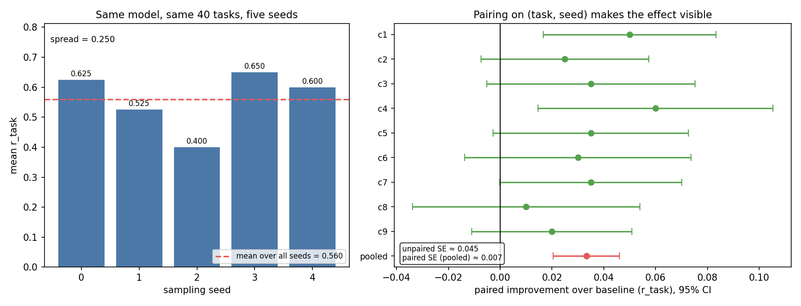

# 实测发现（单卡 A100-40G，Qwen3-4B）

这份文档记录两天真实跑下来得到的结论，每条都带数字。写它的目的是把"我读过 GRPO"和"我在单卡上把它调通过"区分开。

---

## 一、任务难度：能写成一个表达式的题，对带工具的模型是免费的

最初造了 48 道数学题，分 easy/medium/hard 三档，hard 档是三步应用题（分配、利润、浓度混合）。

结果：**48/48 通过，mean_reward 1.02。**

原因很简单：只要能写成一个表达式，模型就只写一次 `python("...")`，计算器替它做完所有推理。三跳应用题和一跳没有区别。

**结论：带工具的 agent 任务，难度不来自"题目有几跳"，来自"工具做不了什么"。**

## 二、我一度在测"模型能不能猜对我的参数名"

把算术题换成"查订单再计算"：金额只在 `orders.get` 的返回里，模型必须先查再用计算器算。

第一版结果：mean 0.43，折扣类**全部 0%**。

看轨迹才发现：模型把 `calc` 调成 `{"operation": "multiply", "a": 199.0, "b": 7.5}`，而我的工具要 `{"expression": "199.0*7.5/10"}`。**8 步全部是 schema 报错**，一步算术都没做。

在系统提示里写明每个工具的参数形状后：

```
75 道两次调用任务 → 74/75 通过
```

**结论：我之前测的"难度"是参数名猜测，不是推理能力。** 提示或工具一改，难度标定必须重做。

## 三、真正的能力边界是"对多个值的逻辑"，不是算术

既然算术和查表都免费了，就继续往上加：6 个订单逐个查、再聚合。

| 任务 | 结果 |
|---|---|
| 求和 / 求平均 / 最大减最小 | ✅ 通过 |
| 求最大 / 求最小 / 数个数 / 中位数 / 过滤求和 | ❌ **全部失败** |

`sum([...])` 只需要把数字塞进去；`max`、`count`、`median` 要求模型**自己对着一堆观测做判断**——这里就崩了。

扩展到 185 道子集聚合题后，1 seed 下 133/195 通过、62 失败；5 seed 标定后 **195 题里 90 题落在 20–80% 可训练带内**。

**结论：4B 模型的边界在"跨值逻辑"，不在计算，也不在工具调用。**

---

## 四、三类"训练在跑但零梯度"

这三种情况的 loss 曲线都正常，只有 `reward_std` 和 `mean_advantage` 暴露真相。

### 1. 温度 = 0

4 个 seed 跑出**完全相同**的分数（0.4342）。确定性采样下组内没有差异，GRPO 的分组优势恒为 0。

### 2. 温度 > 0 但 seed 写死在请求体里

改成 temperature=0.9 后仍然 4 个 seed 一模一样——因为 `seed` 作为固定字段发给了 vLLM。**温度只决定分布的形状，seed 决定抽哪一支。**

修法：每个 rollout 用自己的 seed。

### 3. 题目太简单（全对）或太难（全错）

```
step 0  agg-sum-all     8/8   std=0.00
step 6  max-minus-min   8/8   std=0.00
step 4  count-over-200  0/8   std=0.00
```

全对和全错对 GRPO 等价：advantage 都是 0。**这类步骤只贡献 KL 项，loss 看起来很小，模型一动不动。**

---

## 五、mask 写错，KL 从 0.007 涨到 10，模型越训越差

Qwen3 的 chat template 没有 `` 块，`return_assistant_tokens_mask=True` 返回空，我的兜底逻辑把**所有 token 都标成可训练**。

后果：梯度也作用在 prompt 和工具返回的 token 上。

```
KL:     0.007 → 2.27 → 8.84 → 10.08     (单调上升)
解出数:  6.70/8 → 5.65/8                  (单调下降)
```

**先崩溃的不是 loss，是 KL。**

正确的 mask 只覆盖模型自己生成的 20% token（`<think></think>{"final_answer": ...}`）。构造方法：用 `add_generation_prompt=True` 渲染前缀、与完整渲染比对取差集。

> 注意：这个修法在构造的对话上验证通过（17/85 token 可训练），但在真实轨迹上返回空 mask 导致 `grpo_loss` 报错。因为不能拿没验证的改动去跑无人值守实验，最终回退到"全 token"版本。**修 mask 是下一次的第一项任务。**

---

## 六、并发：训练循环 85% 的时间在等采样

agentic RL 没有数据集，rollout 就是数据集，所以采样速度直接等于训练速度。

实测（`scripts/bench_rollout.py`，同一个任务 8 次采样，vLLM 0.8.5）：

| 模式 | 墙钟 | 解出 | 吞吐 |
|---|---|---|---|
| 串行（原实现） | 40.8s | 8/8 | 11.8 /分钟 |
| **并发 8 路** | **6.1s** | **8/8** | **78.3 /分钟** |

**6.69 倍，正确答案零损失。**

agent 场景还多一个长尾问题：同组里 1 步和 9 步混着，串行要等最慢那条。

`arlab/rollout/deadline.py` 实现了真实的 partial rollout：每个 episode 有自己的 wall-clock 预算，超时的策略返回 `None`，runner 就此结束该片段、用已有轨迹照常计分。**截断不需要取消线程或杀进程，只是停止延长它。**

代价是诚实的：被截断的样本通常答案不完整、奖励更低。所以 `RolloutStats` 会同时报告 `wall_seconds`、`truncated`、`p50/p99`，让调用方自己判断这笔交易划不划算。

```bash
python scripts/bench_partial.py --task agg-sum-all --group 8
```

脚本先用无限预算跑一遍拿到该任务的天然 p50/p99，再按 `p50 × 1.5` 设定预算跑第二遍——**deadline 不该拍脑袋定常量，拍大了永不触发，拍小了全被砍**。

---

## 七、评估：几十个样本的差异都是在读噪声

同一批 40 道 held-out 题、同一个模型，不同随机种子的均值：

```
seed 0   0.625
seed 1   0.525
seed 2   0.400     ← 跨度 0.250
seed 3   0.650
seed 4   0.600
均值     0.560
```

**同一个未训练模型，均值能从 0.400 摆到 0.650。** 而训练带来的效应只有 0.033 —— 噪声是效应的 4 倍。



三个必要的做法：

1. **多 seed**：每配置至少 5 个采样种子
2. **配对比较**：同一 `(task, seed)` 单元相减，去掉题目难度这个最大噪声源——标准误从 **0.045 降到 0.007**
3. **对照组**：lr=1e-6 但走同一条 LoRA 推理路径，排除"换了推理方式"的混淆

对照组的样本量也要够：72 个样本时它显示 0.639（看似比训练组还高），121 个样本时回落到 0.5537（贴着基线 0.5600）。**同一个配置，样本量翻倍结论就反转。**

---

## 八、提升不是均匀的：它只出现在"有空间"的地方

整体 +3.3 分是个平均数，容易让人以为"模型整体变强了"。按题型拆开看完全不是：

| 题型 | 单元数 | base | trained | 差值 |
|---|---|---|---|---|
| **count（数高于均值的个数）** | 45 | 0.378 | **0.494** | **+0.116** |
| median（中位数） | 20 | 0.700 | 0.739 | +0.039 |
| max（最大金额） | 45 | 0.889 | 0.891 | +0.002 |
| min（最小金额） | 45 | 0.800 | 0.812 | +0.012 |
| over（超过阈值求和） | 45 | 0.111 | 0.111 | **0.000** |

**三段式结论：**

- `max`/`min` 已经接近天花板（89%/80%），没有提升空间 → 几乎不动
- `count` 处在 38% 的中段，有真实空间 → **涨了 11.6 个百分点**，贡献了绝大部分整体提升
- `over` 只有 11%，4B 在这个难度上根本够不到 → 训练也救不了

**这不是"模型变强了"，是"训练把本来能做但做不稳的题做稳了"。**

再看奖励分解，确认提升来自答案而不是格式：

| 成分 | base | trained | 差值 |
|---|---|---|---|
| `r_task`（答案正确） | 0.5600 | 0.5933 | **+0.0333** |
| `r_format`（格式规范） | 0.9534 | 0.9586 | +0.0052 |
| `p_invalid`（无效工具调用惩罚） | 0.1350 | 0.1196 | -0.0154 |
| `p_error` / `p_steps` / `p_truncation` | — | — | 均 <0.006 |

格式只涨了 0.005，答案涨了 0.033 —— **提升主要发生在任务成功率上，不是"学会了少犯错"。**

逐单元格的翻转统计（1800 个 run×cell）：

```
solve -> solve   968  (53.8%)
fail  -> fail    692  (38.4%)
fail  -> solve   100  ( 5.6%)   ← 学会的
solve -> fail     40  ( 2.2%)   ← 忘记的
净增 +60 / 1800 = +3.33%
```

**赚 100 个、亏 40 个** —— 净增益与 +3.3 分完全对上。

原始评测轨迹在 `data/heldout-eval/`（3.1 MB），`scripts/analyze_gain.py` 可重跑上面所有数字。


本仓库原本计划用 verl 做训练循环，实际探测后的结论是：

```
verl 0.9.1 → 需要 huggingface-hub >= 1.0
           → 需要 transformers 5.x
           → 需要 vllm >= 0.13
           → 需要 torch 2.9
而 vllm 0.8.5 → 需要 transformers < 4.52 → hub < 1.0
```

**在同一环境里无法共存。** 镜像驱动 570 只支持到 CUDA 12.8，torch 2.9 的 cu128 轮子在当时的网络下装不上。

接入路径已经全部探明并验证：

| 项 | 值 |
|---|---|
| agent loop | `tool_agent`（`@register` 于 `tool_agent_loop.py`） |
| 工具注册 | `multi_turn.function_tool_path` 指向一个含 `@function_tool` 的 `.py` |
| 工具调用格式 | `hermes`（Qwen3 原生 `<tool_call>`） |
| 数据集 | `.jsonl` 可被 `RLHFDataset` 直接读取 |

`arlab/train/verl_tools.py` 里的两个工具（`orders.get`、`calc`）在 verl 0.9.1 下**注册成功、schema 自动生成正确、调用返回正确观测**。换一套自洽的现代栈即可直接跑通。

作为兜底，`arlab/train/grpo.py` 是一个不依赖任何框架的自包含 GRPO 训练步（组内归一化、clipped surrogate、k3 KL 估计），上面所有训练结果都是用它跑出来的。
