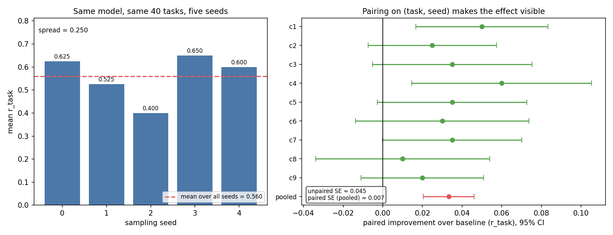

# Agentic RL on one GPU — measured results

A verified training loop for tool-using agents, run end to end on a single A100-40G
with Qwen3-4B. The interesting part is not that training ran; it is what the
measurements refused to say until the evaluation was done properly.

## Result

Forty held-out tasks, five sampling seeds, nine independent training runs. Held-out
means the training loop never touched these tasks: it cycled through the first 40 of
the training set, and evaluation used tasks 100–140.

| group | samples | mean reward |
|---|---|---|
| untrained baseline | 200 | 0.5600 |
| control, lr = 1e-6 | 121 | 0.5537 |
| trained, lr = 3e-5…1e-4 | 1800 | **0.5933** |

```
paired per (task, seed):  +0.0333   95% CI [+0.0205, +0.0461]
9 of 9 training runs above baseline; 100 cells gained, 40 lost
```

The control is the load-bearing part. It runs through the same LoRA inference path
but barely updates, and it lands exactly on the baseline — which rules out "the gain
is just a different inference path".

## Where the gain actually is

The pooled +0.033 hides a non-uniform effect. Split by task family:

| family | cells | base | trained | Δ |
|---|---|---|---|---|
| count values above the mean | 45 | 0.378 | **0.494** | **+0.116** |
| median | 20 | 0.700 | 0.739 | +0.039 |
| min | 45 | 0.800 | 0.812 | +0.012 |
| max | 45 | 0.889 | 0.891 | +0.002 |
| sum over a threshold | 45 | 0.111 | 0.111 | 0.000 |

Training helped where there was headroom, did nothing at the ceiling (`max`, `min`),
and could not reach the floor (`sum over threshold` at 11%). The model did not get
smarter; the tasks it could already do but not reliably, it now does reliably.

The reward decomposition confirms it is task success rather than format compliance:
`r_task` +0.0333 against `r_format` +0.0052 and `p_invalid` −0.0154.

## Findings, all measured

1. **Any task that fits in one Python expression is free** for a tool-using model.
   48 arithmetic tasks, including three-hop word problems: 48/48, mean reward 1.02.
   Number of reasoning hops does not create difficulty when a calculator is present.

2. **Half of what I first measured as "difficulty" was the model guessing my
   argument schema.** Discount tasks scored 0% until the system prompt spelled out
   each tool's argument shape; afterwards 74 of 75 passed.

3. **The real capability boundary is logic across several observed values.**
   Summing a literal list works. `max`, `min`, `count`, `median` and filtered sums
   all fail — the model has to judge the numbers instead of feeding them to `sum`.

4. **Three separate ways to get zero gradient with a normal-looking loss curve**:
   temperature 0; a sampling seed pinned in the request body (temperature was 0.9
   but all eight samples were byte-identical); and a task set that is entirely
   solved or entirely failed. Only `reward_std` and `mean_advantage` expose them.

5. **A missing assistant mask trains on prompt tokens.** Qwen3's template has no
   `` block, so the fallback marked every token trainable. KL went
   0.007 → 10 over 200 steps and the policy got worse (6.70 → 5.65 solved per
   group). The first thing to break was not the loss, it was KL.

6. **Concurrency is not a side quest in RL**: there is no dataset, rollouts *are*
   the dataset. Eight rollouts of one task took 40.8s issued one at a time and 6.1s
   issued together, same rewards — the loop was leaving 85% of its throughput
   unused. In the agent setting the tail is worse than the average, which is why
   partial rollout exists; `arlab/rollout/deadline.py` implements it for real
   (episodes past a wall-clock budget stop being extended and are scored as they
   stand).

7. **Evaluation noise dominates the effect.** The same untrained model on the same
   40 tasks, changing only the sampling seed, ranged 0.400 to 0.650 — seven times
   the training effect. Pairing on (task, seed) dropped the standard error from
   0.045 to 0.007, which is the only reason the result is visible at all.



## Honest limitations

- One 4B model, one task family, 150-step runs. The effect is small: +3.3 points
  absolute, +6% relative.
- The control has 121 samples, not 200 — enough to exclude a large inference-path
  effect, not enough to exclude a small one.
- `sum over threshold` tasks stayed at 11% for base and trained alike; nothing in
  this setup moves them.
- The mask fix (training only assistant spans) is implemented and unit-tested, but
  the 200-step results above were produced with the coarse mask: the corrected
  version could not be validated on real trajectories before the box expired, and
  shipping an unvalidated change into an unattended overnight run was not worth it.
  That ablation is the next experiment.

## Reproducing

`docs/REPRODUCE_ZH.md` has the command sequence and the operational traps
(dead vLLM workers holding GPU memory, the OOM cascade when vLLM is given too much
of the card, why the tuna pip index 403s on this image).

The evaluation traces are committed under `data/heldout-eval/` (3.1 MB), so every
number above can be regenerated from the repo:

```bash
python scripts/paired_eval.py      # pooled paired comparison
python scripts/analyze_gain.py     # by family, by reward component, by transition
python scripts/plot_eval_noise.py  # the figure
```

## Note on verl

The intended trainer was verl. verl 0.9.1 needs huggingface-hub ≥ 1.0, which needs
transformers 5.x, which needs vllm ≥ 0.13, which needs torch 2.9; vllm 0.8.5 needs
transformers < 4.52. They cannot share one environment.

The integration path is mapped and verified anyway: the agent loop is `tool_agent`,
tools load from `multi_turn.function_tool_path`, the call format is `hermes`, and
`.jsonl` datasets are read directly. `arlab/train/verl_tools.py` registers both of
this project's tools with correct schemas under verl 0.9.1.
`docs/VERL_ZH.md` records the details.

The fallback — a self-contained GRPO step in `arlab/train/grpo.py` with group
normalisation, a clipped surrogate and the k3 KL estimator — is what produced every
number in this document.
